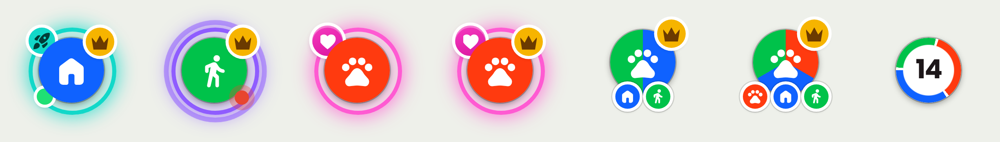
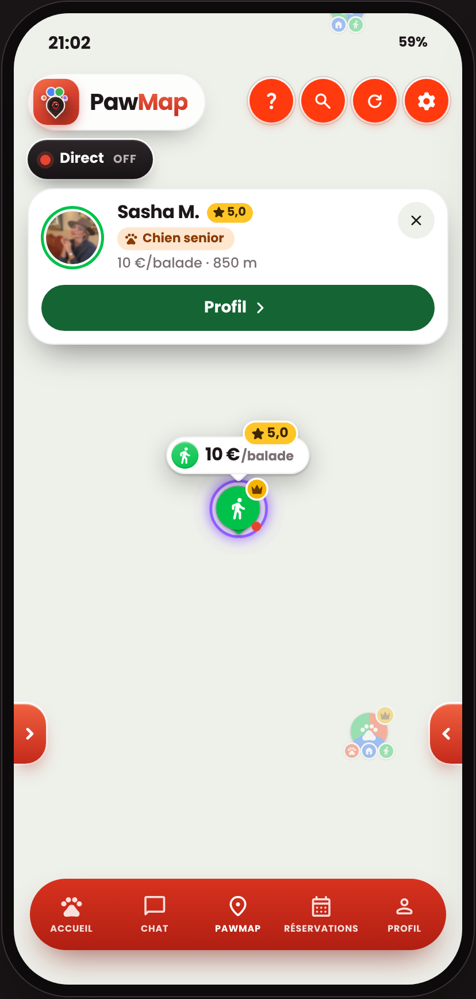
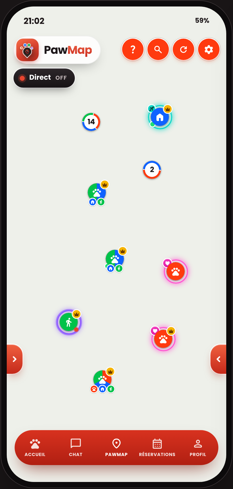
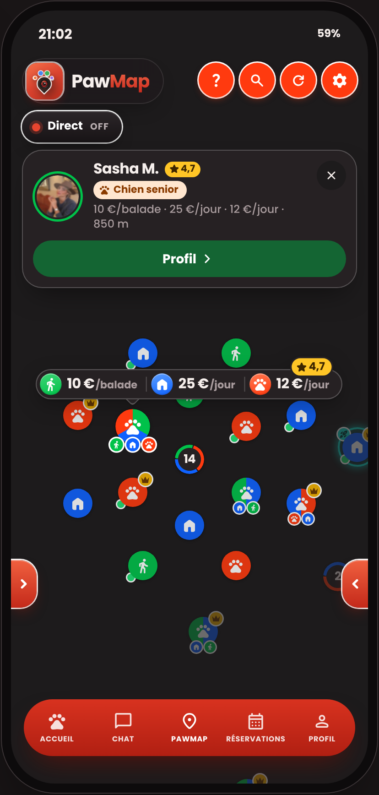

# Handoff PawMap — Pastilles de la carte (design v2)

> **À lire en premier.** Ce handoff ne concerne **que l'aspect visuel** des pastilles de la carte et de ce qui s'affiche autour d'elles. **Aucune logique, aucune donnée, aucun écran ne doit changer.** Si une modification demande de toucher à autre chose que du style (couleurs, tailles, formes, ombres, animations d'apparition), **ne pas la faire** et le signaler.

Ce document remplace la partie « design » de `design_handoff_pawmap_marqueurs`. Les **comportements** décrits dans ce premier handoff restent valables tels quels.

---

## 1. Périmètre (STRICT)

### On change — uniquement le dessin de :

1. **Pastilles de profil** sur la carte (les ronds).
2. **Halos** autour des pastilles (PawBoost, PawFollow, Ami) : même signification, même règle, nouveau dessin.
3. **Petits badges** posés sur la pastille : couronne PawPremium, fusée PawBoost, cœur Ami, point « disponible », point « en direct ».
4. **Ronds de groupe** (clusters).
5. **Bulle de prix** affichée au toucher, et sa petite étiquette de note.
6. **Couleurs des rôles** (plus vives), partout où elles servent déjà : pastilles, bulles, 4 boutons en haut à droite.

### On ne touche PAS

- **La logique des halos** : un seul halo à la fois, la couronne PawPremium par-dessus, et l'ordre de priorité (suivi en direct → PawBoost → PawFollow → Ami). Le code actuel de l'app fait foi.
- **La règle « qui voit quels prix »** (`visiblePrices`), le calcul des groupes, l'éclatement d'un groupe, le zoom et les mouvements de caméra.
- **Les données et l'API** : aucun nouveau champ, aucune nouvelle requête, aucun changement de modèle.
- **La fiche profil** qui s'ouvre au toucher (nom, étiquette, prix, distance, bouton « Profil ») : elle existe déjà et reste comme elle est. Elle apparaît dans la maquette seulement pour montrer que la pastille et la fiche cohabitent.
- **Le reste de l'écran** : menu du bas, logo PawMap, pastille « Direct », flèches latérales, fond de carte.
- **La navigation**, les autres écrans, le site web.

### Deux éléments conditionnels

Le **point vert « disponible maintenant »** et la **note en étoiles** ne sont à afficher **que si l'app possède déjà cette information** côté client. Si la donnée n'existe pas : ne rien afficher, ne rien créer.

---

## 2. Fichiers du dossier

| Fichier | Rôle |
|---|---|
| `README.md` | Ce document (la référence). |
| `HANDOFF-PawMap-Pastilles.pdf` | Le même contenu, avec les captures, pour lecture humaine. |
| `PawMap - Bulles HD.dc.html` | Maquette interactive. **Style retenu : A · Anneau** (sélectionné par défaut). Les styles B à E sont d'anciennes pistes : les ignorer. |
| `support.js`, `assets/` | Nécessaires pour ouvrir la maquette dans un navigateur. |
| `screenshots/` | Captures de référence (voir section 9). |

Dans la maquette, le fond de carte peut apparaître uni : seules les pastilles comptent.

Toutes les mesures sont en **points logiques** (pt / dp / px CSS à 1×). La maquette est dessinée sur un écran de 390 × 844.

---

## 3. Couleurs

### Rôles (plus vives qu'avant)

| Rôle | Couleur pleine | Ancienne valeur | Dégradé pour la pastille d'icône de la bulle | Icône (Material Symbols Rounded, pleine) |
|---|---|---|---|---|
| Propriétaire | `#ff3a0f` | `#f23b16` | `#ff7a52` → `#ff3a0f` | `pets` |
| Gardien | `#0f62ff` | `#1a6cff` | `#5ea0ff` → `#0f62ff` | `home` |
| Promeneur | `#00c24a` | `#12b350` | `#3fd476` → `#00c24a` | `directions_walk` |

### Halos et badges

| Élément | Couleur | Remarque |
|---|---|---|
| PawBoost | `#12d8c9` (turquoise) | Si l'app a déjà une constante turquoise, la garder. |
| PawFollow | `#8f5cff` (violet) | Si l'app a déjà une constante violette, la garder. |
| Ami | `#ff5ad2` (rose fuchsia) | **À appliquer** : l'ancien rose se confondait avec l'orange Propriétaire. |
| PawPremium (couronne) | fond `#f6b400`, couronne `#6b3a00` | |
| Disponible maintenant | `#1fe074` | |
| En direct (point) | `#e8452f` | Inchangé. |
| Note (étiquette) | fond `#ffc526`, texte `#3d2600` | |

### Surfaces (bulle de prix, étiquette de groupe)

| | Thème clair | Thème sombre |
|---|---|---|
| Fond | `#ffffff` | `#262123` |
| Texte principal | `#1d1719` | `#f6efec` |
| Texte secondaire | `#7a6f71` | `#a99c9e` |
| Liseré intérieur 1 pt | `rgba(0,0,0,.07)` | `rgba(255,255,255,.22)` |
| Trait séparateur | `rgba(0,0,0,.14)` | `rgba(255,255,255,.18)` |

---

## 4. Pastille de profil

*De gauche à droite : PawBoost · PawFollow · Ami · Ami + Premium · 2 rôles · 3 rôles · Groupe.*

### Base

- Rond de **32 pt**, **rempli entièrement de la couleur du rôle**. Couleur pleine : pas de dégradé, pas de reflet.
- **Pas de bord blanc, pas d'anneau intérieur, pas de cercle blanc.** La couleur va jusqu'au bord.
- Pour la détacher de la carte : un filet de 0,5 pt `rgba(0,0,0,.25)` et une ombre courte `0 1pt 3pt rgba(0,0,0,.35)`.
- Icône du rôle, blanche, **17 pt**, centrée.
- Petite ombre au sol sous la pastille (ellipse 18 × 6 pt, noir 38 % au centre, transparent au bord) : inchangée.

### Plusieurs rôles (2 ou 3)

- Le rond est découpé en **parts égales** aux couleurs des rôles (camembert, départ en haut, sens horaire), icône `pets` blanche au centre.
- Sous le rond : une **mini-pastille par rôle**, 12 pt, couleur du rôle, icône blanche 8 pt, liseré blanc 1,5 pt, espacées de 3 pt, centrées, haut de la rangée à 27 pt du haut du rond (elles mordent de 5 pt sur le bas du rond).

### Sélection (au toucher)

- Comportement inchangé : la pastille grossit (échelle 1,18, avec rebond) et les autres s'estompent.
- **Nouveau, visuel seulement** : une petite **pointe** de la couleur du rôle sort sous la pastille sélectionnée (carré de 9 pt tourné à 45°, coin arrondi 2 pt, placé derrière le rond, dépassant d'environ 4 pt). Uniquement pour un profil à un seul rôle ; pas de pointe quand il y a des mini-pastilles de rôle.

---

## 5. Halos et badges

**Rappel : la règle ne change pas.** Un seul halo à la fois, choisi par le code existant. Seul le dessin change.

### Dessin commun du halo

- Un anneau **derrière** la pastille, de **43 pt** de diamètre (il dépasse de 5,5 pt tout autour).
- Bord de **2 pt** de la couleur du halo.
- Intérieur rempli de la couleur du halo à **22 %** d'opacité.
- Lueur autour : flou 9 pt, étalement 1 pt, couleur du halo à **75 %**.

### Ce qui distingue chaque cas

| Cas | Couleur | En plus du halo |
|---|---|---|
| **PawBoost** | turquoise | Badge **fusée** en haut à gauche : rond 13 pt turquoise, décalé de −5 pt, liseré blanc 1,5 pt, icône `rocket_launch` 9 pt en `#003d38`. |
| **PawFollow** | violet | Une **onde** : un second anneau identique (bord 2 pt violet, sans fond) qui grandit de 1 à 1,6 en s'effaçant (opacité 0,75 → 0), 1,8 s, en boucle. |
| **Ami** | rose fuchsia | Badge **cœur** en haut à gauche : rond 15 pt, décalé de −6 pt, dégradé `#f73cc0` → `#d9159f` (160°), liseré blanc 1,5 pt, cœur blanc de 8 × 7,3 pt **centré** dans le rond. |

La fusée et le cœur occupent la même place : ils ne peuvent pas apparaître ensemble, puisqu'il n'y a qu'un halo à la fois.

### Autres badges

- **Couronne PawPremium** — toujours visible, en plus du halo. Rond doré 14 pt en haut à droite, décalé de −5 pt, liseré blanc 1,5 pt, couronne `#6b3a00` occupant 60 % de la largeur et 50 % de la hauteur du rond. **La couronne doit être bien visible** : dans la version précédente elle ne s'affichait pas.
- **Disponible maintenant** *(seulement si la donnée existe)* — point vert 8 pt en bas à gauche, décalé de −1 pt, liseré blanc 1,5 pt.
- **En direct** — point rouge 7 pt en bas à droite, décalé de −1 pt, liseré blanc 1,5 pt, pulsation existante conservée.

Si l'utilisateur a activé « réduire les animations », couper l'onde PawFollow et l'animation d'apparition de la bulle.

---

## 6. Ronds de groupe

- **32 pt**, soit **la même taille que les pastilles** (avant : 48 pt).
- Fond blanc (`#262123` en thème sombre). **Pas de contour blanc extérieur.** Même filet et même ombre que les pastilles.
- Sur le bord : un anneau de **3,3 pt** découpé proportionnellement au nombre de profils de chaque rôle, avec un petit écart entre les parts.
- Au centre : le nombre, 13 pt, très gras, couleur du texte principal.
- Étiquette « dès X € » (affichage inchangé, seulement quand le groupe est touché) : pilule de 24 pt de haut, fond de surface, liseré intérieur 1 pt, un point de 7 pt de la couleur du rôle, « dès » en 10 pt secondaire, le prix en 12 pt très gras couleur du texte principal.

---

## 7. Bulle de prix

**Affichage inchangé** : uniquement quand on touche un profil, au-dessus de la pastille, sans jamais sortir de l'écran (marge 12 pt). Seul le dessin change.

- **Une seule pilule** pour tous les prix : hauteur 28 pt, coins entièrement arrondis, fond de surface (clair ou sombre selon le thème), liseré intérieur 1 pt, marge intérieure horizontale 4 pt.
- **Un bloc par rôle**, côte à côte :
  - pastille d'icône ronde de 20 pt, en dégradé du rôle (voir tableau des couleurs, angle 160°), icône blanche 13 pt ;
  - à 5 pt : le montant en **13 pt très gras**, couleur du texte principal ;
  - puis l'unité (« /jour », « /balade ») en 9,5 pt demi-gras, couleur secondaire ;
  - 8 pt de marge à droite.
- Entre deux blocs : un **trait vertical** de 1 × 14 pt (couleur « trait séparateur »).
- **Pointe** sous la pilule : carré de 11 pt tourné à 45°, coin arrondi 3 pt, même fond que la pilule, dépassant d'environ 6 pt. Elle reste alignée sur la pastille même quand la bulle est décalée pour rester dans l'écran.
- **Ombre** : `0 1pt 1pt rgba(0,0,0,.2)` + `0 6pt 9pt rgba(0,0,0,.24)`.
- **Position** : le bas de la bulle est à 21 pt au-dessus du centre de la pastille.
- **Apparition** : 280 ms, la bulle monte de 6 pt, grossit de 0,7 à 1 avec un léger rebond et passe de transparente à opaque.

Changement de fond par rapport à l'ancienne version : le texte n'est plus blanc sur la couleur du rôle (peu lisible sur le vert) mais **foncé sur fond clair**. La couleur du rôle reste dans la pastille d'icône.

### Étiquette de note *(seulement si la donnée existe)*

- Petite pilule dorée posée **à cheval sur le bord supérieur** de la bulle, à 10 pt du bord droit, remontée de 10 pt.
- Hauteur 16 pt, fond `#ffc526`, liseré 1,5 pt de la couleur du fond de la bulle.
- Étoile pleine 11 pt + note (« 4,8 ») en 10 pt très gras, le tout en `#3d2600`.
- Elle est placée là pour **ne pas élargir la bulle** : avec trois prix, une note dans la bulle la ferait sortir de l'écran.

---

## 8. Les 4 boutons en haut à droite

Rien ne change, sauf la **couleur** : ils prennent la nouvelle couleur vive du rôle actif (tableau de la section 3).

---

## 9. Captures de référence

| Fichier | Ce qu'elle montre |
|---|---|
| `screenshots/01-carte-clair.png` | Vue d'ensemble, thème clair, rien de sélectionné. |
| `screenshots/02-pastille-touchee-clair.png` | Une pastille touchée : bulle de prix, note, pointe, halo PawFollow. |
| `screenshots/03-groupe-ouvert-sombre.png` | Un groupe ouvert en thème sombre, bulle à trois prix. |
| `screenshots/04-etats-pastilles.png` | Tous les états d'une pastille, agrandis. |
| `screenshots/zoom-*.png` | Chaque état, séparément, agrandi 5×. |

---

## 10. Ce qui change par rapport au handoff précédent

| Élément | Avant | Maintenant |
|---|---|---|
| Taille de la pastille | 50 pt | **32 pt** |
| Fond de la pastille | blanc, avec anneau de couleur et centre coloré | **couleur pleine jusqu'au bord** |
| Bord blanc | oui | **non** |
| Halo coloré du rôle sous la pastille | oui | **non** (les halos servent aux abonnements) |
| Couleurs des rôles | `#f23b16` / `#1a6cff` / `#12b350` | `#ff3a0f` / `#0f62ff` / `#00c24a` |
| Mini-pastilles de rôle | 17 pt | 12 pt |
| Couronne PawPremium | 17 pt, souvent invisible | 14 pt, couronne bien visible |
| Halos PawBoost / PawFollow / Ami | — | redessinés (section 5) |
| Rond de groupe | 48 pt, contour blanc | **32 pt, sans contour blanc** |
| Bulle de prix | un segment de couleur par rôle, texte blanc | une pilule claire, texte foncé, pastilles d'icône colorées |
| Note, point « disponible », pointe de sélection | — | ajoutés (visuel, conditionnel) |

---

## 11. Vérifications avant de livrer

- [ ] Aucun fichier de logique, de données ou de navigation n'a été modifié : seulement des styles et des composants d'affichage de la carte.
- [ ] Toutes les pastilles et tous les ronds de groupe font **32 pt**.
- [ ] Plus aucun bord blanc ni anneau blanc sur les pastilles.
- [ ] Un seul halo par pastille, et la couronne PawPremium visible par-dessus.
- [ ] L'ordre de priorité des halos est resté celui du code d'origine.
- [ ] Le rose « Ami » se distingue clairement d'une pastille orange Propriétaire.
- [ ] Le cœur est centré dans son rond ; la couronne est visible dans son rond doré.
- [ ] Bulle à trois prix près d'un bord : elle reste dans l'écran, la pointe reste sur la pastille.
- [ ] Thème clair et thème sombre.
- [ ] La fiche profil s'ouvre toujours au toucher, exactement comme avant.
- [ ] Note et point « disponible » : affichés seulement si la donnée existe déjà.
